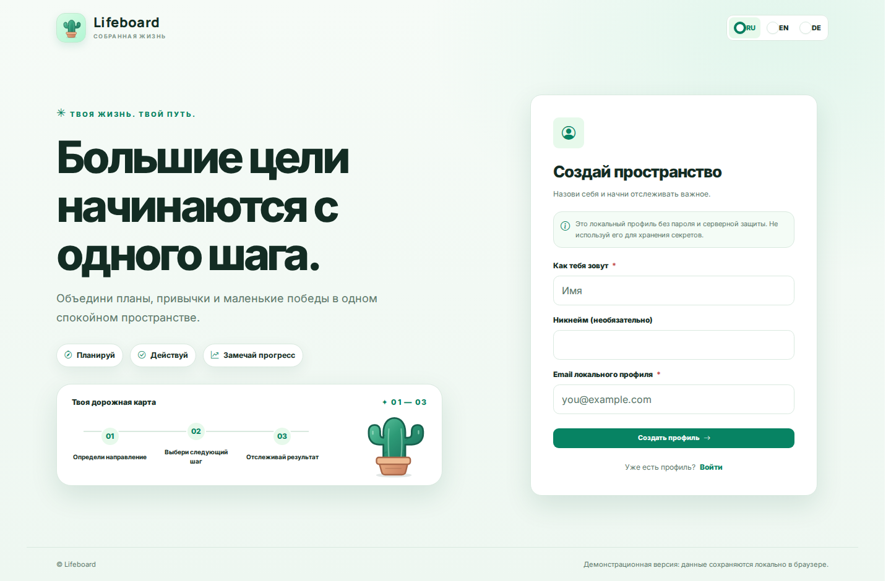
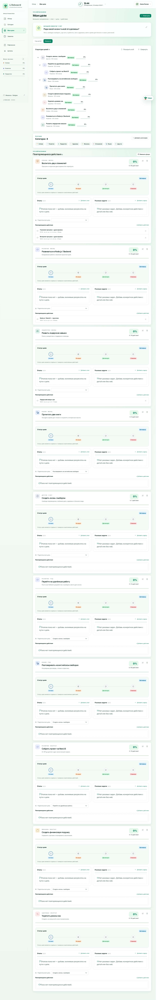
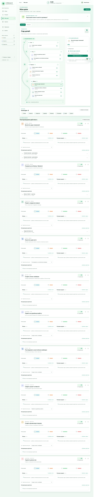
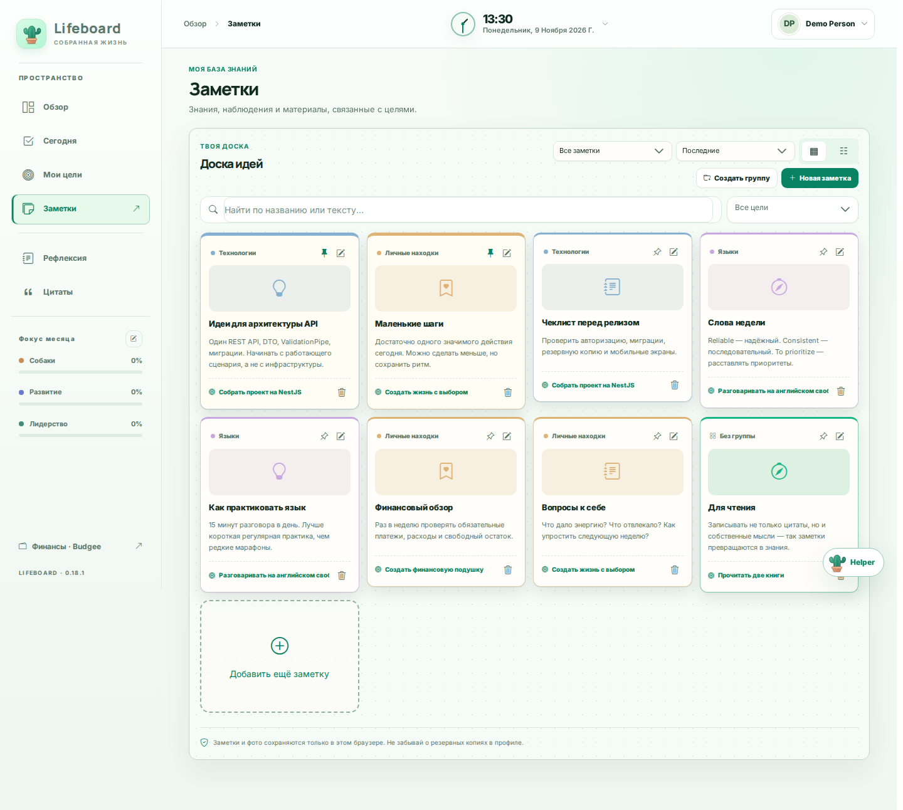
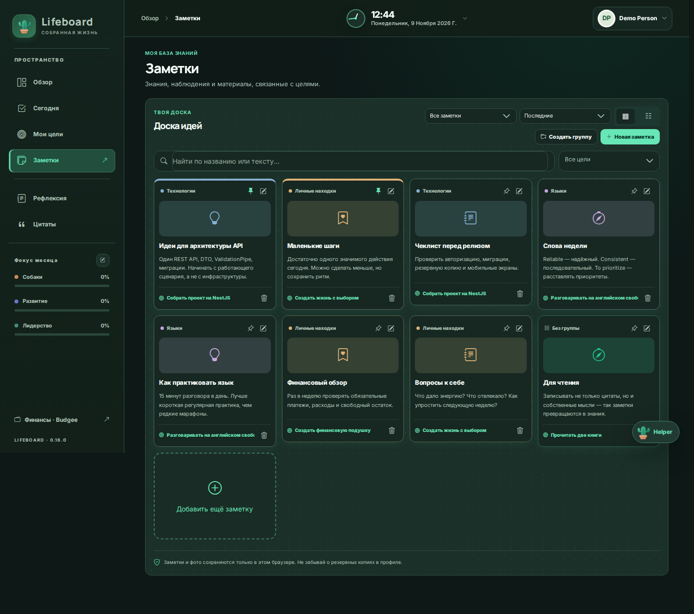
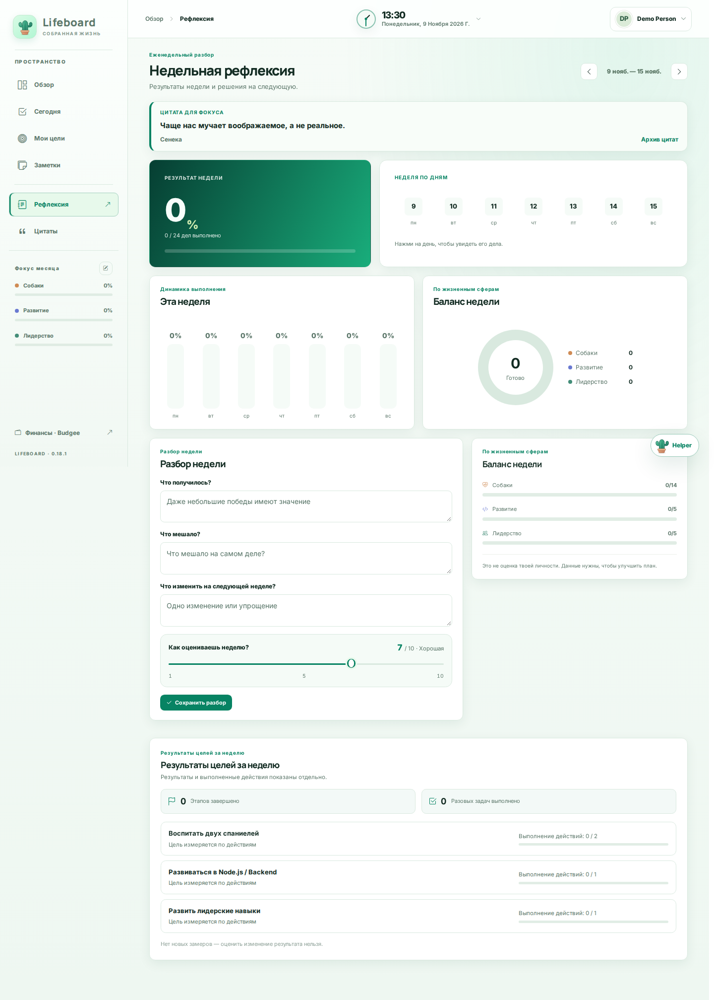
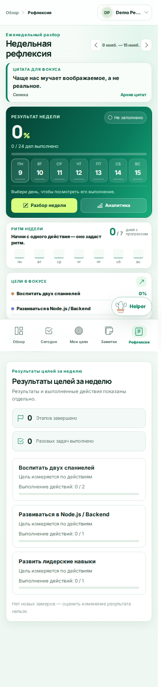
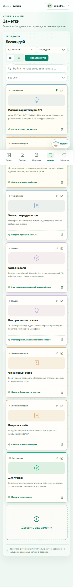

<div align="center">

# 🌵 Lifeboard

### Твои цели. Твой ритм. Твой прогресс.

**Frontend 1.0.0 · Vue 3 · TypeScript · Pinia · PrimeVue · Vite 8 · Bun**

</div>

> **Статус релиза:** интерфейс и локальный режим готовы к публикации как **демо / локальный frontend**. Интеграция с NestJS backend 1.0.0 **ещё не реализована**: авторизация пока локальная, а пользовательские данные хранятся в браузере. Это **не готовый production-сервис с серверными аккаунтами**. В этом релизе **не добавлен API-слой** и не реализован обмен данными с backend.



## 📸 Интерфейс

| Дерево целей | Сад целей |
|:--:|:--:|
|  |  |

| Заметки — светлая тема | Заметки — тёмная тема |
|:--:|:--:|
|  |  |

| Еженедельная рефлексия, desktop | Рефлексия, mobile |
|:--:|:--:|
|  |  |

<p align="center"></p>

Скриншоты из `docs/screenshots/` получены из демо-данных. Для пересъёмки: `bun run screenshots` после установки Chromium через Playwright. В репозитории они **не** обновляются автоматически в CI; изменения скриншотов проверяются вручную.

## Возможности

- Цели на разные горизонты, связи, статусы, прогресс, вехи, задачи и отметки результатов.
- Режимы «Сад» и «Дерево», фокус-цели, ежедневные и повторяемые действия.
- Заметки с группировкой, изображениями, привязкой к целям и поиском.
- Еженедельная рефлексия, системные цитаты, статистика и настройки профиля.
- RU / EN / DE, светлая / тёмная / оранжевая темы, адаптация под мобильные экраны.
- Jakk — фирменный кактус. Helper временно показывает `InDevelop`; никаких сетевых запросов к Helper в этом релизе нет.
- Локальный JSON-экспорт и импорт `LifeState v1` — до перехода на backend **обязательно сохраняйте бэкапы**.

## Быстрый старт

**Требования:** Bun **1.4.4**, Node.js 22+ (для инструментов), Chromium для браузерных тестов.

```bash
bun install --frozen-lockfile
bun run check:release
bun run dev
```

Приложение: <http://localhost:8080>.

В локальном режиме регистрация создаёт профиль **только в этом браузере**, вход по email **не проверяет пароль**. Не используйте эту схему для реальной многопользовательской авторизации. Данные находятся в `localStorage` и `sessionStorage`; очистка данных сайта может привести к их потере.

## Проверки перед релизом

```bash
bun run check:release  # декларации пакетов, Docker, локальные импорты, скриншоты, ключи хранения
bun run build          # сборка Vite → dist/
bun run test:all       # Vitest
bun run build-storybook
bunx playwright install chromium
bun run test:browser   # Playwright E2E
bun run screenshots    # только при осознанном обновлении снимков README
```

`check:release` — **статический контроль**, не заменяет настоящую сборку, unit, браузерные и security-тесты. Дополнительно см. [гайд по тестированию](docs/TESTING.md) и [release checklist](docs/RELEASE_CHECKLIST.md).

## Docker / сервер

Сборка полностью переведена на **Bun**. `Dockerfile` использует `oven/bun:1.4.4`, `bun.lock` и Nginx; Yarn больше не используется.

```bash
docker compose build --no-cache lifeboard
docker compose up -d --no-deps --force-recreate lifeboard
docker compose ps
curl -fsS http://127.0.0.1:8080/healthz
```

Адрес: `http://<server-ip>:8080`. Действующие контейнеры на других портах не должны затрагиваться этими командами. Перед обновлением сохраните ZIP/копию исходного каталога и сделайте **JSON-экспорт** пользовательских данных из браузера. Инструкции по резервной копии, развертыванию и откату: [DEPLOYMENT.md](docs/DEPLOYMENT.md).

Для публичного развертывания потребуется HTTPS, корректный DNS, reverse proxy и проверка CORS/cookie при будущем включении backend. Nginx frontend в текущем Docker обслуживает только статику — **не проксирует `/api/v1`**.

## Архитектура

```text
src/
  main.ts                         # Vue / Router / Pinia / PrimeVue / i18n
  modules/
    auth/                         # только локальный демонстрационный профиль
    profile/                      # UI профиля
    lifeboard/
      views/                      # Overview, Today, Goals, Notes, Reflection, Quotes
      components/                 # UI по доменам, JakkLauncher -> InDevelop
      stores/useLifeStore.ts      # существующее browser-local хранилище LifeState v1
      composables/useLifeBackup.ts
      types.ts                    # модели текущего UI
  shared/
    components/Brand/            # кактус, логотип, лоадер
    components/Feedback/         # AsyncStateView и InDevelop
    composables/                  # useAsyncState / useApiRequest: UI-состояния будущих запросов
    lib/apiErrors.ts              # универсальное отображение ошибок
    stores/                       # текущий локальный профиль и настройки
  core/                           # i18n, стили, PrimeVue
  index.css
public/                           # favicon.svg и SVG маскота
docs/screenshots/                 # скриншоты на демо-данных
```

### Подготовка к backend 1.0.0 (API-слой **не реализован**)

| Клиентский сценарий | Текущая реализация | Будущая ответственность |
|---|---|---|
| Вход и регистрация | `useAuthStore` — локальный профиль | HTTP-only cookie-сессия; получение `/users/me` |
| Цели, фокус, показатели, задачи, статусы | `useLifeStore` | NestJS `/goals`, `/goal-checkins`, `/tasks` и связанные маршруты |
| Распорядок, отметки | `useLifeStore` | `/routines`, отметки по датам |
| Заметки, группы, изображения | `useLifeStore` и data URL | `/notes`, `/note-groups`, `/files` (S3 через backend) |
| Reflection и цитаты | `useLifeStore` | `/reviews`, `/quotes`, `/progress/week` |
| Миграция существующих данных | локальный импорт/экспорт | `/imports/lifeboard-v1`, `/exports/lifeboard-v1` |

**Следующий шаг — написать отдельные доменные адаптеры, подключить stores к ним и заменить локальную сессию.** Готовых HTTP-клиентов, эндпоинтов в коде UI и скрытого переключателя режима нет. Существующие `useAsyncState`, `useApiRequest` и `AsyncStateView` — только повторно используемые механизмы отображения загрузки/ошибок и отмены устаревших операций, не интеграция.

Подробная [карта интеграции по реальным контроллерам backend 1.0.0](docs/BACKEND_INTEGRATION.md), [соглашения для асинхронного UI](docs/API_ASYNC.md). Источник истины по API при запуске backend: Swagger `/api/docs`, OpenAPI `/api/docs-json`.

**Важно:** backend использует `lifeboard.sid` (`HttpOnly`, `SameSite=Lax`, `Path=/api/v1`), `WEB_ORIGIN` и Origin-проверку для изменяющих запросов. После написания API-клиента понадобится `credentials: 'include'`; токен **не** должен попадать в JS, `localStorage` или `VITE_*`. Рекомендуется same-origin HTTPS через reverse proxy. Запрещено незаметно мигрировать или перезаписывать локальные данные: сначала бэкап и dry-run импорта, затем явное подтверждение пользователя.

## Область релиза

**Входит:** визуальная часть Lifeboard, локальный режим, сохранение совместимости `LifeState v1`, чистка неиспользуемого UI, исправления Docker/Bun/CI, документация и точки интеграции.

**Не входит:** сетевой API-клиент и вызовы NestJS, настоящая авторизация/сессия, серверная синхронизация, миграция данных без подтверждения, интеграция S3 в UI, функциональность Helper.

## Лицензия

[AGPL-3.0](LICENSE)
